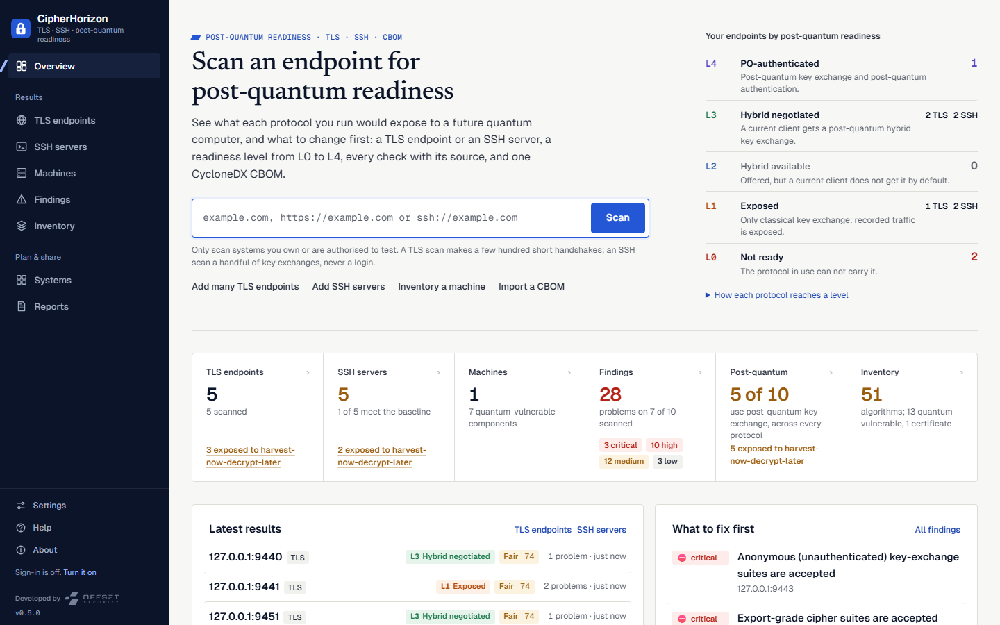
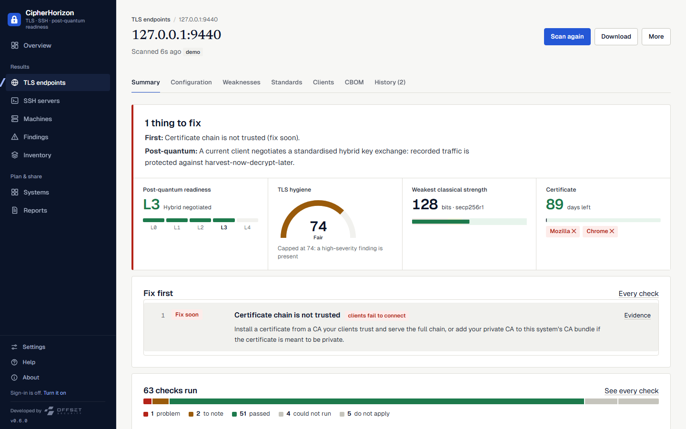
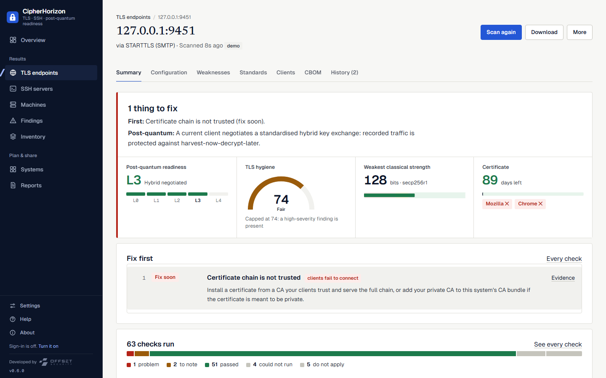
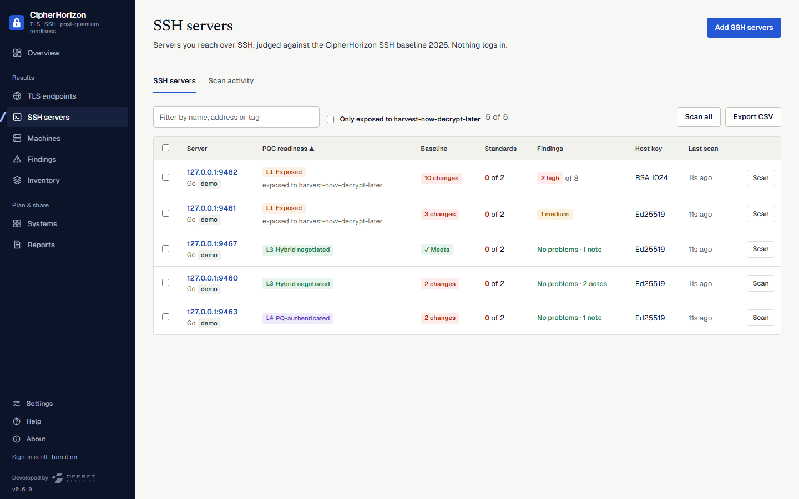
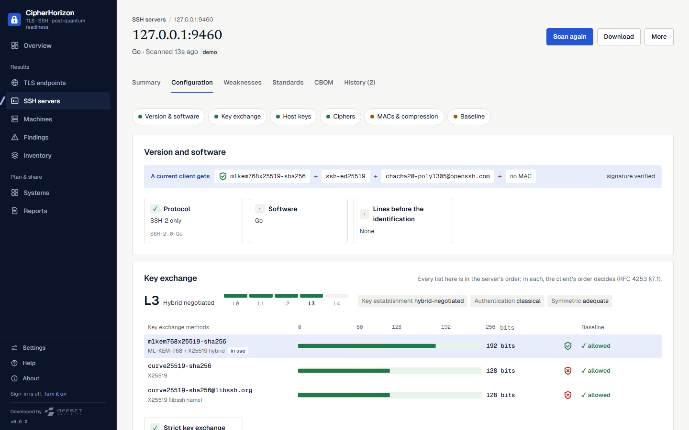
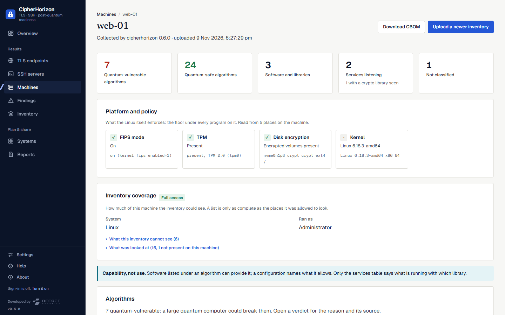
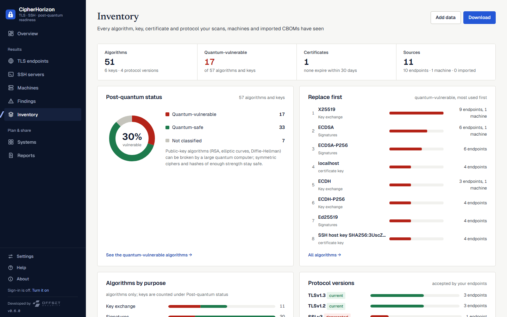

<p align="center">
  
</p>

<h1 align="center">CipherHorizon</h1>

<p align="center">
  <a href="https://github.com/offsetsecurity/cipherhorizon/releases"></a>
  <a href="https://github.com/offsetsecurity/cipherhorizon/actions/workflows/ci.yml"></a>
  <a href="https://github.com/offsetsecurity/cipherhorizon/actions/workflows/codeql.yml"></a>
  <br>
  <a href="go.mod"></a>
  <a href="https://pkg.go.dev/github.com/offsetsecurity/cipherhorizon"></a>
  <a href="docs/exporting.md"></a>
  <a href="LICENSE"></a>
</p>

<p align="center">
  <a href="#quick-start">Quick start</a> ·
  <a href="#what-it-does">What it does</a> ·
  <a href="#what-is-in-it">Features</a> ·
  <a href="#how-it-compares">How it compares</a> ·
  <a href="docs/methodology.md">Methodology</a> ·
  <a href="https://github.com/offsetsecurity/cipherhorizon/releases">Downloads</a>
</p>

**Post-quantum readiness for the protocols your organisation runs on: TLS, SSH and, next, VPN. A deep scan of each,
a readiness level from L0 to L4, and one CycloneDX CBOM, self-hosted.** By [Offset Security](https://offsetsecurity.net/).

> [!NOTE]
> **Pre-release (`0.x`).** It works and is tested against real servers, but options and the API may still change
> before 1.0 ([release checklist](docs/engineering/RELEASE-CHECKLIST-1.0.md)).

Recorded traffic is protected today only if the key exchange was post-quantum: NIST IR 8547 deprecates the
quantum-vulnerable algorithms after 2030 and disallows them after 2035, and anything harvested before then can be
decrypted later. CipherHorizon tells you which of your TLS endpoints and SSH servers are exposed, which machines carry
quantum-vulnerable cryptography, and what to fix first. It runs on your network and sends nothing anywhere.

<picture>
  <source media="(prefers-color-scheme: dark)" srcset="docs/img/overview-dark.png">
  
</picture>

## Quick start

Pick one, then open <http://127.0.0.1:8080>, type an address and press Enter.

**Docker or Podman**

```sh
docker run -d --name cipherhorizon -p 127.0.0.1:8080:8080 -v cipherhorizon-data:/data ghcr.io/offsetsecurity/cipherhorizon:0.7.0
```

**Debian, Ubuntu**, with the `.deb` from the [Releases page](../../releases) (on RHEL or Fedora:
`sudo dnf install ./cipherhorizon-<version>-1.x86_64.rpm`)

```sh
sudo apt install ./cipherhorizon_<version>_amd64.deb
```

**Windows**, with the zip from the [Releases page](../../releases), in a terminal run as administrator: a service
that starts at boot

```powershell
cipherhorizon.exe service install
```

**Any OS** (Linux, macOS, Windows; amd64 and arm64), from the release archive, running in this terminal

```sh
cipherhorizon serve
```

Sign-in is off until you want it: turn it on in **Settings** to give a team accounts and roles, or start with
`--sign-in on`. Another port: `cipherhorizon serve --port 9000` or `CIPHERHORIZON_PORT=9000`. Each OS, where the data
lives, backup, upgrade and removal: [docs/engineering/INSTALL.md](docs/engineering/INSTALL.md).

From the command line, no server needed:

```sh
cipherhorizon tls scan example.com                     # the verdict: readiness, TLS hygiene score, what to fix
cipherhorizon tls scan smtp://mail.example.com         # STARTTLS: SMTP, IMAP, POP3, FTP, XMPP, LDAP, PostgreSQL
cipherhorizon tls scan --fail-on 'level<L3' api.example.com   # exit 3 when it fails: a CI gate
cipherhorizon ssh scan bastion.example.com              # readiness, the SSH baseline, the sshd_config lines to meet it
cipherhorizon ssh scan --fail-on baseline git.example.com      # exit 3 when the server does not meet the baseline
cipherhorizon tls scan --fail-on standard=nist-sp800-52r2 www.example.gov   # exit 3 when a published standard is not met
```

Scan only systems you own or are authorised to test.

## What it does

### 1. Says where each endpoint stands on post-quantum

One question across everything: is recorded traffic exposed to harvest-now-decrypt-later? Every TLS endpoint and SSH
server gets a level from **L0** (the protocol in use cannot carry a post-quantum key exchange) to **L4** (post-quantum
key exchange and authentication), each protocol by its own stated rules. Systems are ranked for migration by exposure
and by how long their data must stay secret.

### 2. Scans TLS and SSH in depth, and shows its work

The TLS scanner is its own wire implementation: every protocol from SSLv2 to TLS 1.3, every cipher suite and
key-exchange group (`X25519MLKEM768` included), the signature schemes (ML-DSA included), and the certificate chain
against the Mozilla and Chrome root stores. Each of its checks says what it found, why it matters, what to do and its
source; the TLS hygiene score (0 to 100) shows its arithmetic. The SSH auditor negotiates as OpenSSH 10.6 would,
verifies every host key, never logs in, and writes the `sshd_config` lines that meet a cited baseline. What it cannot
know, it reports as *unknown* instead of guessing.

| A TLS endpoint: where it stands, then what to fix first | STARTTLS services, the same depth |
|---|---|
|  |  |
| **SSH servers: readiness and the baseline, never a score** | **An SSH server: what a current client gets, every method in bits** |
|  |  |

### 3. Inventories machines, and hands over one CBOM

Two readable scripts (PowerShell and shell) inventory a machine without installing anything and without reading key
material. TLS endpoints, SSH servers, machines and CBOMs imported from other tools merge into one CycloneDX 1.7 CBOM,
with PDF reports and the OMB M-23-02 items per system.

| A machine: platform state, coverage, algorithms and services | The inventory: everything seen, and what to replace first |
|---|---|
|  |  |

## What is in it

| | |
|---|---|
| **TLS endpoints** | SSLv2 to TLS 1.3, every suite and group, signature schemes, the chain against the Mozilla and Chrome root stores or your own CA, OCSP stapling, CRLs, Certificate Transparency, HSTS, DH primes tested. STARTTLS for 7 protocols. Over 60 cited checks. |
| **SSH servers** | Algorithm lists, negotiation as OpenSSH 10.6 would, every host key verified (ML-DSA and the composite `ssh-mldsa44-ed25519` included), 19 cited checks, and the CipherHorizon SSH baseline 2026 with the `sshd_config` lines to meet it. |
| **Post-quantum readiness** | L0 to L4 for every TLS endpoint and SSH server, with harvest-now-decrypt-later exposure. |
| **Classical strength** | Every algorithm, key and cipher suite in bits, by NIST's methods. A suite is as strong as its weakest part, and names it. |
| **Published standards** | Each scan judged clause by clause against RFC 9325, NIST SP 800-52 Rev. 2, BSI TR-02102-2 and -4, the ANSSI TLS guide, Mozilla Modern and Intermediate, PCI DSS v4.0.1 and CNSA 2.0 ([docs/standards.md](docs/standards.md)). |
| **Client simulation** | What two dozen named clients, from current Chrome to Java 6 and IE 8, would negotiate with each TLS endpoint, or why they cannot connect ([docs/clients.md](docs/clients.md)). |
| **Certificates** | Any certificate in a chain as the whole X.509 document: validity, key and signature strength, every extension decoded, the PEM to copy. |
| **Machines** | Platform state (FIPS, TPM, disk encryption, Secure Boot), what OpenSSL and OpenSSH can do, TLS, SSH, VPN and authentication settings, certificates and which provider holds each key, and every listening service with the libraries it loaded. |
| **Inventory** | Everything merged into one CycloneDX 1.7 (or 1.6) CBOM: algorithms with their OIDs, certificates with serial and fingerprint. Every chart opens what it counts. |
| **Findings and systems** | Findings grouped by problem, with triage; systems ranked for migration; OMB M-23-02 export per system. |
| **Reports** | PDF per TLS endpoint, per SSH server and for the whole inventory; CycloneDX, CSV and JSON downloads. |
| **Over time** | Schedules, history, and what changed between two scans. |
| **For teams** | Sign-in when you want it: administrator, analyst and viewer roles, an exportable activity log. |
| **For pipelines** | `tls scan` and `ssh scan` with `--fail-on` gates (exit 3), JSON and CBOM output, and the REST API (`/api/v1/openapi.json`). |
| **For assistants** | An MCP server (`cipherhorizon mcp`, or `/mcp` on the web server): scan from Claude, Cursor or VS Code, ask about the fleet, quote the standard behind a finding; scope, read-only and role controls. |

## How it compares

| | CipherHorizon | testssl.sh, SSLyze | SSL Labs | ssh-audit | New PQC CLIs |
|---|---|---|---|---|---|
| Form | Self-hosted web app and CLI | CLI | Public web service | CLI | CLI |
| Protocols | TLS (with STARTTLS) and SSH | TLS | Public HTTPS | SSH | Varies |
| Internal endpoints | Yes | Yes | No | Yes | Yes |
| History, schedules, accounts and roles | Yes | No | No | No | No |
| A post-quantum readiness level per endpoint | L0 to L4, with HNDL exposure | Lists groups | No | Flags classical key exchange | Varies |
| SSH judged against a policy | A cited baseline, and the `sshd_config` lines to meet it | No | No | Built-in and custom policies | Rarely |
| SSH client audit | No | No | No | Yes | No |
| STARTTLS | 7 protocols | Yes | No | No | Rarely |
| Machine inventory and one CBOM | Yes | No | No | No | Some |
| Active probes (Heartbleed, ROBOT; DHEat for SSH) | No, by design: it sends no exploit or stress traffic | Yes | Yes | DHEat | No |
| Rating | TLS: its own hygiene score, arithmetic shown. SSH: meets the baseline or not | Letter grade | Letter grade | Pass, warn or fail per algorithm | Own scores |

Use testssl.sh when you need active vulnerability probes on one host, and ssh-audit to audit SSH clients or stress
a server's Diffie-Hellman. Use CipherHorizon when you need to know where your estate stands on post-quantum across
protocols, keep track of it, and show the evidence.

## Standards

[NIST IR 8547](https://csrc.nist.gov/pubs/ir/8547/ipd) (transition timeline) ·
[FIPS 203](https://csrc.nist.gov/pubs/fips/203/final) ML-KEM ·
[FIPS 204](https://csrc.nist.gov/pubs/fips/204/final) ML-DSA · FIPS 205 SLH-DSA ·
[RFC 8446](https://www.rfc-editor.org/rfc/rfc8446) and [RFC 9325](https://www.rfc-editor.org/rfc/rfc9325) (TLS) ·
[RFC 4253](https://www.rfc-editor.org/rfc/rfc4253), [RFC 9142](https://www.rfc-editor.org/rfc/rfc9142) and
[RFC 10042](https://www.rfc-editor.org/rfc/rfc10042) (SSH) ·
[CycloneDX 1.6 and 1.7](https://cyclonedx.org/capabilities/cbom/) (CBOM) · OMB M-23-02 (export structure).
The readiness level, the TLS hygiene score and the SSH baseline are this project's own; how each is worked out is in
[docs/methodology.md](docs/methodology.md).

## Security and trust

- **Self-hosted and offline.** One static binary with the interface inside; no telemetry, no external requests
  but the scans you start. A scan contacts only its target.
- **It passes its own scan.** Served over HTTPS, it speaks TLS 1.2 (forward-secret AEAD only) and TLS 1.3 with the
  hybrid post-quantum key exchange, sends HSTS, and the test suite scans it with its own scanner.
- **Accounts when you want them.** Administrator, analyst and viewer roles, PBKDF2 password hashes, sessions that
  end, lock-outs, and an activity log an administrator can export. A server on the network will not start open
  unless told to (`--open-network`).
- **Limits you set.** `--scan-allow` restricts what can be scanned; loopback, link-local and cloud-metadata
  addresses are refused by default.
- **Inventory scripts you can read.** They install nothing, read no key material, and can only run the queries the
  script itself defines; `cipherhorizon scripts list` prints their hashes.
- **Verifiable releases.** Signed checksums (Sigstore), an SBOM per archive and build provenance.

Report vulnerabilities privately: [SECURITY.md](SECURITY.md).

## Documentation

| | |
|---|---|
| [docs/engineering/INSTALL.md](docs/engineering/INSTALL.md) | Installing on each OS, the port, where the data lives, backup, upgrade, removal |
| [docs/deploy.md](docs/deploy.md) | Docker, Caddy with automatic HTTPS, systemd, Windows, backups |
| [docs/CI.md](docs/CI.md) | `tls scan` and `ssh scan --fail-on`, and a GitHub Actions example |
| [docs/mcp.md](docs/mcp.md) | Using CipherHorizon from an assistant (Model Context Protocol): the tools, the safety controls, client setup |
| [docs/methodology.md](docs/methodology.md) | Every check, the readiness levels, the TLS hygiene score, the SSH baseline |
| [docs/tls-scanning.md](docs/tls-scanning.md) | How the TLS scanner works and what it sends |
| [docs/ssh-scanning.md](docs/ssh-scanning.md) | How the SSH auditor works, what it sends, and the SSH baseline |
| [docs/standards.md](docs/standards.md), [docs/clients.md](docs/clients.md) | The published standards, clause by clause; the simulated clients and their sources |
| [docs/estate-guide.md](docs/estate-guide.md) | Systems, machines, migration order |
| [docs/importing.md](docs/importing.md), [docs/exporting.md](docs/exporting.md) | CBOM in and out, OMB M-23-02 |
| [docs/cbom-model.md](docs/cbom-model.md) | What a CipherHorizon CBOM contains, and which parts are CycloneDX |
| [docs/reference-data.md](docs/reference-data.md) | The root stores and other dated lists compiled into the binary |
| [docs/architecture.md](docs/architecture.md) | How it is built |
| `/api/v1/openapi.json` on a running server | The API |

## Try it without touching anyone else's systems

```sh
go run ./cmd/demo-targets                    # servers of known posture on 127.0.0.1:9440 and up
cipherhorizon serve --allow-loopback         # loopback scans are refused unless you say so
```

`demo-targets` prints what each server is and what to expect: a hybrid post-quantum server (L3), classical TLS 1.3
(L1), TLS 1.2 only (L0), a deliberately terrible SSLv3 server, a slow one, a private CA chain, one STARTTLS
service per protocol, and SSH servers from an SSH-1 banner (L0) to an ML-DSA host key (L4), one of them hardened to
meet the baseline. The screenshots on this page are these servers.

## Building and testing

Go 1.27 or newer; no C compiler, no Node, no database server.

```sh
go build -o cipherhorizon ./cmd/cipherhorizon
go test ./...                       # unit and integration tests, including the UI and design rules
golangci-lint run ./...
bash testing/deploy/smoke.sh        # the container, as docker-compose.yml runs it
node testing/e2e/journey.mjs        # the browser journey, see testing/README.md
```

The interface is plain HTML, CSS and JavaScript modules embedded with `go:embed`; storage is SQLite through a pure-Go
driver; the TLS scanner and the SSH auditor are their own wire implementations (`internal/tlsprobe`,
`internal/sshprobe`). The design rules are in [DESIGN.md](DESIGN.md).

## Contributing

Bug reports, corrections to a finding or a citation, and pull requests are welcome: see
[CONTRIBUTING.md](CONTRIBUTING.md) for the setup, conventions and the evidence rule every finding follows.
Everyone participating follows the [Code of Conduct](CODE_OF_CONDUCT.md).

## License and credits

[Apache 2.0](LICENSE). Made by [Offset Security](https://offsetsecurity.net/), whose
[post-quantum readiness practice](https://offsetsecurity.net/post-quantum-cryptography-readiness.html) helps teams
plan the move. Fonts: Geist and Geist Mono (Vercel) and Newsreader, all under the SIL Open Font License.
