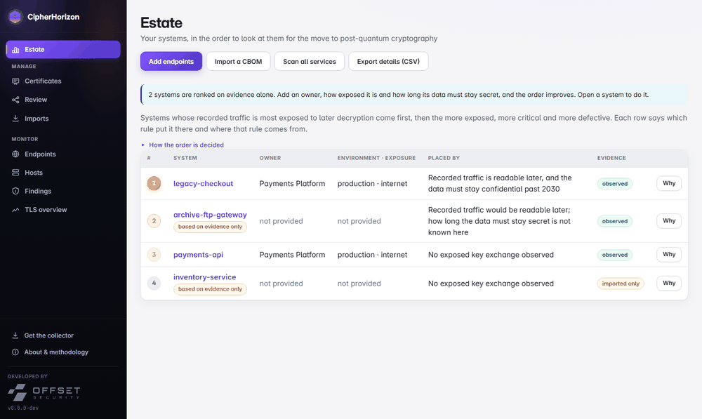

# CipherHorizon

[](https://github.com/example/cipherhorizon/actions/workflows/ci.yml)
[](go.mod)
[](LICENSE)
[](docs/exporting.md)

<!-- placeholder-owner -->
> **Before the first push:** the module path `github.com/example/cipherhorizon` uses a placeholder owner. Run
> `scripts/set-owner.sh <your-github-username>` (rewrites the module path, release config and links, and removes
> this notice). See [docs/engineering/BRANCHING.md](docs/engineering/BRANCHING.md#first-push).
<!-- /placeholder-owner -->

CipherHorizon scans your TLS endpoints and collects your CBOMs into one cryptographic inventory, and tells you what
is not ready for post-quantum. Type an address and press Enter: you get a report that says what to fix first. Every
scan, every machine you inventory and every CBOM you import joins one inventory of algorithms, keys,
certificates and protocols, which you can download as a single CycloneDX CBOM. Open source and vendor-neutral.



- **Active TLS/SSL scanner and posture score**: protocol versions (SSLv2 to TLS 1.3), every cipher suite, key-exchange
  groups including post-quantum hybrids such as `X25519MLKEM768`, and certificates, each endpoint scored 0-100 (a
  **TLS hygiene** band) and rated **PQC readiness** L0-L4, with a cited finding and remediation for every point lost —
  never a bare number. The report opens on what to fix first; every section is one line until you open it.
- **One cryptographic inventory**: every algorithm, key, certificate and protocol your scans, machines and imported
  CBOMs have seen, with its post-quantum status and where it was seen, downloadable as one CycloneDX CBOM.
- **Systems** (secondary): systems in the order to look at them, by four published, cited rules (traffic exposed to
  later decryption against how long its data must stay secret, exposure and criticality, certificate and TLS defects,
  strength of evidence). No composite score: every row says which rule put it there and where it is from.
- **Systems, certificates, review, imports**: a *system* is what an owner answers for. Its services, machines and
  certificates (with key sizes) hang under it; likely matches between a service and a machine are proposed for a person to
  confirm or reject; documents from other tools are imported with provenance and never overwrite what was observed.
- **CBOM as an interchange format**: `cipherhorizon run`, `cipherhorizon-collector run` and `cipherhorizon tls scan --cbom`
  write a [CycloneDX](https://cyclonedx.org/capabilities/cbom/) **1.7** CBOM (`--spec 1.6` for older consumers) with
  evidence-based post-quantum classifications, and third-party CBOMs can be imported. Per system, the nine items of
  OMB M-23-02 can be exported as JSON or CSV (it supports the structure; it is not a compliance statement). See
  [docs/estate-guide.md](docs/estate-guide.md), [docs/exporting.md](docs/exporting.md), [docs/importing.md](docs/importing.md) and the OpenAPI description served at `/api/v1/openapi.json`.

### Start here

1. Run `cipherhorizon serve` and open <http://127.0.0.1:8080>. The first screen is a scan box.
2. **Check a server's TLS:** type `example.com:443` and press Enter. You get its report: a readiness level, a hygiene
   score and what to fix first. *Scan many endpoints* adds a list at once; every report stays under *Reports*.
3. **Inventory a machine:** under *Inventory → Add data → Inventory a machine*, take the short inventory script for
   the machine (PowerShell for Windows, shell for Linux; plain text you can read first), run it there, and upload
   the `cipherhorizon-facts-<machine>.txt` it writes. The server turns those facts into a CBOM with a post-quantum
   verdict for every algorithm, and the machine's page shows how complete the inventory is and what it could not see.

*Inventory* gathers everything, and **Download CBOM** there exports it as one document. More detail: [How to start](#how-to-start) below.

**Status: pre-release, `0.x`.** Interfaces can still change between minor versions ([versioning policy](docs/engineering/RELEASING.md#versioning-policy)).
The first tagged release (`0.1.0`) is written up in the [release report](docs/product/RELEASE-REPORT-001.md); the
cryptographic estate model above it is written up in [QA-REPORT-002](docs/program/QA-REPORT-002.md), not yet tagged.

## Tech stack

| Layer | What is used |
|---|---|
| Language and build | **Go** (module targets Go 1.25). One statically linked binary, `CGO_ENABLED=0`, no runtime to install. |
| Web server and API | Go standard library `net/http` (method-aware `ServeMux`); a JSON API under `/api/v1`. |
| Web UI | Plain **HTML, CSS and JavaScript ES modules**, hand-drawn SVG charts. No framework, no npm, no build step. The files in `web/static` are compiled into the binary with `go:embed`, so the UI works offline. |
| Storage | **SQLite** through the pure-Go driver `modernc.org/sqlite` (no C compiler needed), WAL mode, embedded forward-only migrations. The whole state is one file. |
| TLS scanning | An **own TLS wire-protocol implementation** (`internal/tlsprobe/wire`) so it can offer what Go's `crypto/tls` cannot (SSLv2/3, export and anonymous suites, arbitrary groups). Go's `crypto/tls` is used only to fetch certificates and to show what a current client negotiates. IANA cipher-suite and group registries are generated from the registry CSVs. |
| CBOM | `github.com/CycloneDX/cyclonedx-go`; CycloneDX **1.7** by default (`--spec 1.6` for older consumers), `github.com/package-url/packageurl-go`; output validated against the vendored CycloneDX JSON schema of the matching version in tests (`santhosh-tekuri/jsonschema`). |
| Config | YAML (`go.yaml.in/yaml/v3`) for the host inventory command. |
| Tests and tooling | `go test` (unit, integration against in-process servers, fuzzing), `golangci-lint`, and a browser end-to-end script (Node 22+, no dependencies, drives Chrome/Edge over the DevTools protocol). GitHub Actions for CI. |

Security choices worth knowing: **sign-in is required** — accounts with administrator, analyst and viewer roles,
passwords stored as salted PBKDF2-SHA256 hashes, server-side sessions in an HttpOnly, SameSite=Strict cookie that
end after 30 minutes idle or 12 hours, lockout and rate limits against guessing, and a sign-in log
([ADR-0018](docs/decisions/ADR-0018-accounts-and-sign-in.md)); the server serves HTTPS itself (`--tls-cert`) and
refuses plain HTTP beyond loopback unless a TLS proxy is in front; scan targets are checked in the dialer against link-local, cloud-metadata and (by default) loopback addresses; the UI
sends a strict Content-Security-Policy and renders everything it received from a scanned server as text.

## How to start

### What you need

- **Go 1.25 or newer** to build. Nothing else: no C compiler, no Node, no database server.
- A modern browser to use the UI. (Node 22+ is needed only to run the browser end-to-end test.)

### Inventorying a machine (a script, nothing to install)

To inventory a machine you do **not** need to install anything on it. The server hands out two short scripts,
`cipherhorizon-inventory.ps1` (Windows PowerShell 5.1+) and `cipherhorizon-inventory.sh` (POSIX shell: Debian,
Ubuntu, RHEL, Fedora, SUSE, Alpine). Each is a small **engine** with a fixed set of read-only capabilities; **what** it
collects comes from the server's **signature database** ([internal/signatures/signatures.json](internal/signatures/signatures.json)),
written into the script when you download it and listed item by item in the UI (what, from where, how, why). To
collect something new, add a signature: the engines do not change. The scripts install nothing, run no other
program, make no network connection and never read a private key; they write a plain-text facts file you can read
before uploading. The server interprets it with the same sensors and knowledge base as the Go collector
([machine facts](internal/machinefacts/facts.go)).

The Go **`cipherhorizon-collector`** still exists and sees more on Windows (CNG algorithms and providers, crypto DLLs
by their import tables). It is not offered for download because an unsigned binary is hard to trust; build it from
source (`go build ./cmd/cipherhorizon-collector`) if you want it
([ADR-0011](docs/decisions/ADR-0011-separate-endpoint-collector.md)).

### Install

Download an archive for Linux, macOS or Windows (amd64/arm64) from the
[Releases](../../releases) page, verify it ([how](docs/engineering/DISTRIBUTION.md#verifying-a-download)),
extract it and run `cipherhorizon serve`. Or use the container image once one is published
(`docker run -p 127.0.0.1:8080:8080 -v data:/data ghcr.io/<owner>/cipherhorizon:<version>`),
or build one locally with `docker compose up -d` (reads [docker-compose.yml](docker-compose.yml); `docker compose
logs` shows the first-run setup code) or plain `docker build .`, or
`go install github.com/<owner>/cipherhorizon/cmd/cipherhorizon@<version>`. What each release contains and how
it is built and signed: [docs/engineering/DISTRIBUTION.md](docs/engineering/DISTRIBUTION.md).

### Build and run

```sh
git clone <this repository> && cd <it>
go build -o cipherhorizon ./cmd/cipherhorizon       # on Windows: go build -o cipherhorizon.exe ./cmd/cipherhorizon
./cipherhorizon serve                            # on Windows: .\cipherhorizon.exe serve
```

Then open **http://127.0.0.1:8080**. Stop it with Ctrl+C (running scans are cancelled cleanly).
The data is kept in `./cipherhorizon.db` in the directory you started it from (SQLite also creates `-wal` and `-shm`
files next to it). Delete those to start over.

### First use

1. On **Scan**, type one `host[:port]` (443 by default) and press Enter. The report opens and fills in as the scan
   runs; **Cancel** stops it. For a list, choose *Scan many endpoints* and paste one per line: a pasted URL is reduced
   to its host and port, and one bad line never blocks the others.
2. Read the report: **PQC readiness**, **TLS hygiene**, **Fix first**, then one line per section. Sections with a
   problem are open; *Why and sources* under a finding gives the evidence and citations.
3. **Reports** lists every endpoint with its latest result. Scan again later (or set an automatic rescan) and open the
   **History** tab of a report to compare two scans.
4. **Inventory** merges every scan, machine inventory (from the inventory scripts, `cipherhorizon-collector run` or `cipherhorizon run`) and
   imported CBOM into one table with a quantum verdict per algorithm, and **Download CBOM** exports it.

Scan only systems you own or are authorised to test: a scan makes a few dozen to a few hundred short TLS
handshakes per endpoint.

### Try it without touching anyone else's systems

```sh
go run ./cmd/demo-targets                    # servers of known posture on 127.0.0.1:9440-9447; prints what to expect
./cipherhorizon serve --allow-loopback           # scans of loopback addresses are refused unless you say so
```

Add the addresses `demo-targets` prints. They cover a hybrid post-quantum server (L3), a classical TLS 1.3 server
(L1), a TLS 1.2-only server (L0), a deliberately terrible SSLv3 server, a closed port, a slow server (to watch
progress and cancel), and a server you can switch between classical and hybrid with
`curl -X POST http://127.0.0.1:9447/pq/on` to produce a real history change. The demo servers use self-signed
certificates, so their TLS hygiene scores include the untrusted-certificate finding.

### Options for `serve`

| Flag | Default | Meaning |
|---|---|---|
| `--addr` | `127.0.0.1:8080` | Address to listen on. Beyond loopback it needs HTTPS (`--tls-cert`) or `--plain-http`. |
| `--db` | `cipherhorizon.db` | SQLite file (created if missing). |
| `--tls-cert`, `--tls-key` | none | Serve HTTPS (TLS 1.2 and 1.3; Go offers the hybrid post-quantum key exchange first). |
| `--plain-http` | off | Allow plain HTTP beyond loopback because a TLS-terminating proxy is in front (or the port is published only on this host). |
| `--session-idle`, `--session-max` | 30m, 12h | Sign a browser out after this long idle, and after this long in any case. |
| `--no-login` | off | No accounts or sign-in: one local operator. Loopback only. |
| `--token`, env `CIPHERHORIZON_TOKEN` | none | An automation token: scripts and CI may call the API with `Authorization: Bearer <token>`, acting as an analyst. |
| `--allow-loopback` | off | Let scans target loopback addresses (for testing). |
| `--allowed-host` | none | Extra `Host` header accepted in `--no-login` mode (repeatable). |
| `--max-concurrent-scans` | 2 | Scans that may run at once. |
| `--concurrency` | 4 | Connections in flight to one endpoint at once. |
| `--timeout` | 8s | Per-connection timeout during a scan. |

**First run.** The server prints a one-time setup code in its log. Open the UI, enter the code and create the
administrator; the administrator then adds the other accounts under **Users** (each gets a temporary password it
must replace at first sign-in). Locked out? On the server's console:
`cipherhorizon user reset-password --db cipherhorizon.db NAME` (the password is read from standard input), or
`user unlock`, `user add`, `user list`.

To use it from other machines, serve HTTPS directly or put it behind a TLS-terminating reverse proxy:

```sh
./cipherhorizon serve --addr 0.0.0.0:8443 --tls-cert server.crt --tls-key server.key
./cipherhorizon serve --addr 0.0.0.0:8080 --plain-http     # only behind a TLS proxy
```

### Command line

```sh
./cipherhorizon tls scan example.internal:443    # probe one endpoint, print the raw probe report (see docs/tls-scanning.md)
./cipherhorizon tls scan --cbom example.internal:443   # ...or as a CycloneDX CBOM of what the scan observed
./cipherhorizon run                              # inventory this host, CBOM JSON to stdout
./cipherhorizon run --config config.yaml -o host.cbom.json
./cipherhorizon plugins                          # list built-in collectors
./cipherhorizon version
```

Example [`config.yaml`](docs/config.example.yaml) for `run`:

```yaml
output:
  path: host.cbom.json # empty = stdout
host:
  root: /              # use /host when running in a container with the host FS mounted
plugins:
  disabled: []
pqc:
  enabled: true
```

Exit codes: `0` success · `1` fatal error · `2` result produced, but a collector failed or a scan was incomplete.

## How to read the results

**PQC readiness** answers "would recorded traffic survive a future quantum computer?"

| Level | Meaning |
|---|---|
| **L0 Not ready** | No TLS 1.3, so no post-quantum key exchange is possible |
| **L1 Exposed** | TLS 1.3 available, no post-quantum key exchange offered |
| **L2 Hybrid available** | A hybrid group is accepted but a current client does not end up using it |
| **L3 Hybrid negotiated** | A current client negotiates a hybrid post-quantum key exchange |
| **L4 PQ-authenticated** | Post-quantum key exchange and a post-quantum certificate signature |
| **?** Undetermined | The scan could not establish it, so no level is given rather than a guess |

**TLS hygiene** answers "how well is this endpoint configured today?" It is a 0 to 100 score with a band:
**Strong** (90+), **Sound** (75+), **Fair** (55+), **Weak** (30+), **Broken** (below 30). It starts at 100 and takes
points off for each cited finding (critical 40, high 20, medium 10, low 4), and a critical or high finding caps the
score. Every point taken off is listed on the endpoint page with the finding it came from. Post-quantum findings
are not counted, so the two measures stay independent.

Both scales are this project's own and are not standards or another scanner's ratings. The facts they rest on cite
their sources (FIPS 203/204, RFC 9325, IANA registries, NIST IR 8547 draft, ...). The full rules are in
[docs/methodology.md](docs/methodology.md) and on the UI's *About* page.

## Project layout

| Path | What |
|---|---|
| `cmd/cipherhorizon` | the program; `cmd/demo-targets` is a development-only set of demo servers |
| `internal/app` | command-line entry points (`run`, `tls scan`, `serve`) |
| `internal/server` | HTTP API, scan runner and scheduler, target safety checks |
| `internal/store` | SQLite storage, history, fleet summaries |
| `internal/eval` | findings, PQC readiness, TLS hygiene, scan-to-scan diff |
| `internal/tlsprobe` | the TLS scanner, its wire protocol code, registries, and test servers |
| `internal/evidence`, `internal/knowledge`, `internal/derive`, `internal/sense`, `internal/discover`, `internal/hostinfo` | host discovery: sensors, evidence graph, cited capability |
| `internal/cbom`, `internal/pqc`, `internal/algo`, `internal/collector` | CBOM projection, post-quantum verdicts, algorithm catalogue |
| `web/static` | the UI (embedded into the binary) |
| `docs` | architecture, TLS scanning, methodology, sensor guide, product documents |
| `testing` | golden CBOMs, fixtures, schemas, and the browser end-to-end scripts |

## Design principles

1. **Push, not pull, for hosts.** The agent runs on the host; nothing logs in to your machines. (Active TLS
   scanning is the deliberate exception: it connects out to the endpoints you list.)
2. **Single static binary**, UI embedded, works air-gapped, no telemetry.
3. **Plugin-first.** Every collector implements one small interface; the core never contains collector logic.
4. **CycloneDX-native.** 1.6 baseline. Closed enumerations go through total lookup tables; unmappable values are
   *omitted*, never guessed.
5. **Complexity is opt-in.** No queues, no multi-region: SQLite and one process.
6. **Evidence-based.** Every verdict cites a standard or OID; every fact says whether it was observed, inferred,
   taken from a registry, or not measured. No citation, no verdict.
7. **Safe by default.** Loopback bind, token for anything else, SSRF guard on scan targets, strict CSP.

See [docs/architecture.md](docs/architecture.md), [docs/tls-scanning.md](docs/tls-scanning.md),
[docs/methodology.md](docs/methodology.md) and [docs/writing-a-sensor.md](docs/writing-a-sensor.md). The product
documents are in [docs/product](docs/product): PRD, engineering handoff, QA plan, QA report and release report.

## Testing

```sh
go test ./...                                  # unit, integration (real scanner vs in-process servers), UI asset checks
golangci-lint run ./...
go test ./internal/tlsprobe/wire -run '^$' -fuzz FuzzReadFlight -fuzztime 30s
node testing/e2e/journey.mjs                   # browser journey against a running server, see testing/README.md
```

`go test -race` needs a C compiler; CI runs it on Linux. The browser journey and the live security checks are
described in [testing/README.md](testing/README.md).

## Not in scope for R1

Alerts and webhooks, HTTP-layer checks (HSTS), STARTTLS, multi-user auth, an agent daemon that pushes to the
server, custom CA bundles, PDF reports, SSH probing. Source-code analysis belongs to CBOMkit / sonar-cryptography
and image scanning to Trivy.

## Contributing

Bug reports, corrections to a finding or citation, and pull requests are welcome — see
[CONTRIBUTING.md](CONTRIBUTING.md) for the development setup, coding conventions, and the evidence/citation
rule every PQC verdict or TLS finding has to follow. Please report security vulnerabilities privately, per
[SECURITY.md](SECURITY.md), rather than as a public issue. Everyone participating is expected to follow the
[Code of Conduct](CODE_OF_CONDUCT.md).

## License

[Apache 2.0](LICENSE).
