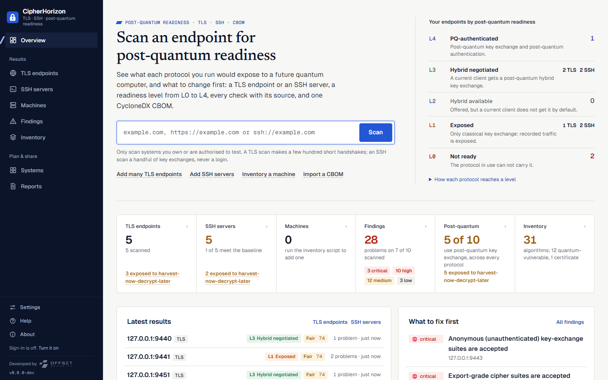
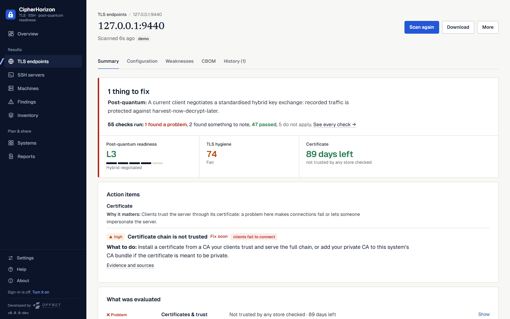
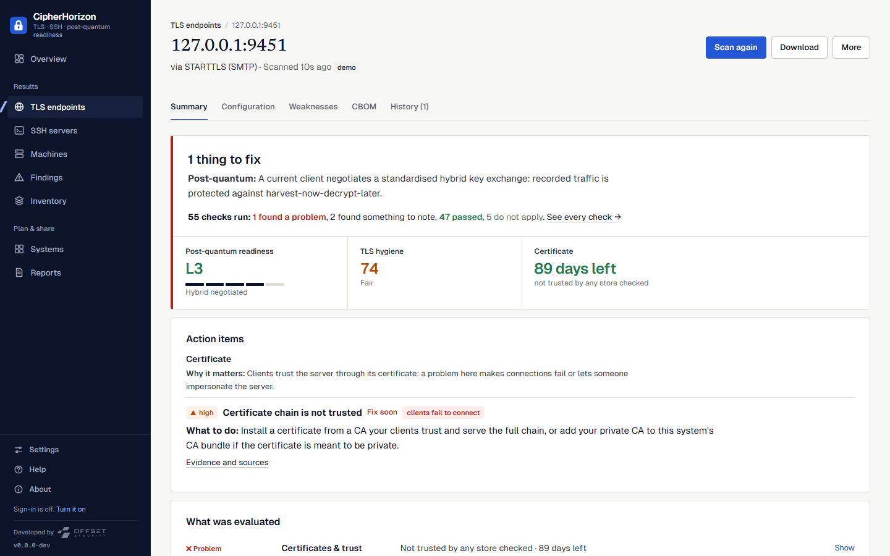
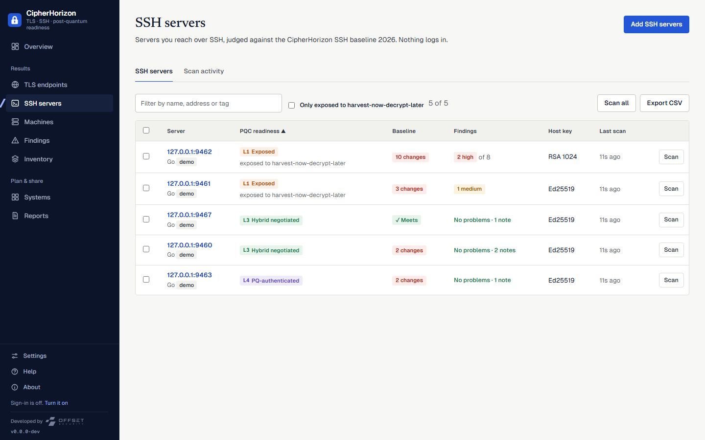
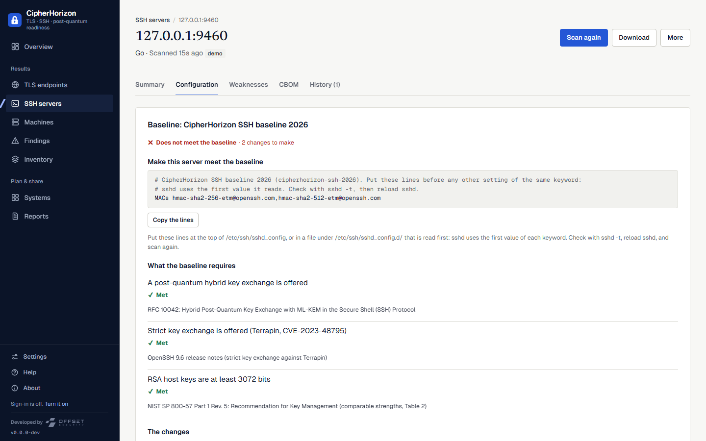

# CipherHorizon

[](https://github.com/offsetsecurity/cipherhorizon/actions/workflows/ci.yml)
[](go.mod)
[](LICENSE)
[](docs/exporting.md)


**Post-quantum readiness for the protocols your organisation runs on: TLS, SSH and, next, VPN. A deep scan of each,
a readiness level from L0 to L4, and one CycloneDX CBOM, self-hosted.** By [Offset Security](https://offsetsecurity.net/).

Recorded traffic is protected today only if the key exchange was post-quantum: NIST IR 8547 deprecates the
quantum-vulnerable algorithms after 2030 and disallows them after 2035, and anything harvested before then can be
decrypted later. CipherHorizon tells you which of your TLS endpoints and SSH servers are exposed, which machines carry
quantum-vulnerable cryptography, and what to fix first. It runs on your network and sends nothing anywhere.



## Quick start

```sh
docker compose up -d                                          # or: podman compose up -d
sudo apt install ./cipherhorizon_<version>_amd64.deb          # Debian, Ubuntu (dnf install … .rpm on RHEL, Fedora)
cipherhorizon.exe service install                             # Windows, as administrator: a service that starts at boot
cipherhorizon serve                                           # any OS, from the release archive, in this terminal
```

Downloads (Linux, macOS, Windows; amd64 and arm64) are on the [Releases page](../../releases). Each OS, where the
data lives, backup, upgrade and removal: [docs/engineering/INSTALL.md](docs/engineering/INSTALL.md).

Open <http://127.0.0.1:8080>, type an address, press Enter. Sign-in is off until you want it: turn it on in
**Settings** to give a team accounts and roles, or start with `--sign-in on`.

Another port: `cipherhorizon serve --port 9000`, or set `CIPHERHORIZON_PORT=9000` (containers and services; the
health check follows it). If the port is taken, `serve` says so and suggests the next one. Every way of running it:
[Choosing the port](docs/engineering/INSTALL.md#choosing-the-port).

From the command line, no server needed:

```sh
cipherhorizon tls scan example.com                     # the verdict: readiness, TLS hygiene score, what to fix
cipherhorizon tls scan smtp://mail.example.com         # STARTTLS: SMTP, IMAP, POP3, FTP, XMPP, LDAP, PostgreSQL
cipherhorizon tls scan --fail-on 'level<L3' api.example.com   # exit 3 when it fails: a CI gate
cipherhorizon ssh scan bastion.example.com              # readiness, the SSH baseline, the sshd_config lines to meet it
cipherhorizon ssh scan --fail-on baseline git.example.com      # exit 3 when the server does not meet the baseline
```

Scan only systems you own or are authorised to test.

## Three things it does well

**Post-quantum readiness, protocol by protocol.** One question across everything: is recorded traffic exposed to
harvest-now-decrypt-later? Every TLS endpoint and SSH server gets a level from L0 (the protocol in use cannot carry
a post-quantum key exchange) to L4 (post-quantum key exchange and authentication), each protocol by its own stated
rules. Systems are ranked for migration by exposure and by how long their data must stay secret.

**Scanners that show their work.** The TLS scanner is its own wire implementation: every protocol from SSLv2 to
TLS 1.3, every cipher suite and key-exchange group (including `X25519MLKEM768`), the signature schemes (ML-DSA
included), the certificate chain against the bundled root stores, OCSP stapling, CT and HSTS. Its 55 checks each say
what they found or that they passed, why it matters, what to do and their sources; the TLS hygiene score (0 to 100)
shows its arithmetic. The SSH auditor reads what a server offers, negotiates as OpenSSH 10.6 would (ML-KEM hybrid
included), verifies every host key, and never logs in. It judges the server against a cited baseline and writes the
`sshd_config` lines that would make it meet it. Both are checked against real servers: OpenSSL for trust, OpenSSH
9.2 and 10.0 for SSH.

**An inventory you can hand over.** Two short, readable scripts (PowerShell and shell) inventory a machine without
installing anything; CBOMs from other tools can be imported. TLS endpoints, SSH servers and machines merge into one
CycloneDX 1.7 CBOM, with PDF reports for each endpoint and for the whole inventory, and the OMB M-23-02 items per system.

| A TLS endpoint: verdict first, then every check | STARTTLS services, the same depth |
|---|---|
|  |  |
| **SSH servers: readiness and the baseline, never a score** | **The `sshd_config` lines that meet the baseline** |
|  |  |

## What is in it

| | |
|---|---|
| **TLS endpoints** | Every protocol from SSLv2 to TLS 1.3, every cipher suite and key-exchange group (hybrids such as `X25519MLKEM768` included), the TLS 1.3 signature schemes (ML-DSA included), the certificate chain against the Mozilla and Chrome root stores or your own CA, OCSP stapling, Certificate Transparency and HSTS. STARTTLS for SMTP, IMAP, POP3, FTP, XMPP, LDAP and PostgreSQL. 55 cited checks and the TLS hygiene score. |
| **SSH servers** | Identification and algorithm lists, negotiation as OpenSSH 10.6 would (the ML-KEM hybrid included), every host key fetched and verified (Ed25519, ECDSA, RSA, ML-DSA and the composite `ssh-mldsa44-ed25519`), 18 cited checks, and the CipherHorizon SSH baseline 2026 with the `sshd_config` lines to meet it. It never logs in. |
| **Classical strength** | Every algorithm, key and cipher suite in bits, computed with NIST's own methods (the GNFS estimate for RSA and DH, half the order for curves, SP 800-57 for ciphers and hashes). A suite is as strong as its weakest part and names it, on the report, the PDF, the CLI, the Inventory, SSH reports and the CBOM (`classicalSecurityLevel`). Every algorithm is classed as asymmetric, symmetric or hash, and each report opens its Configuration with the algorithms it uses, by class. |
| **Certificates** | Open any certificate in a chain to read the whole X.509 document: identity, names, key and signature with their strengths, every extension decoded, fingerprints, and the PEM to copy or download. |
| **Post-quantum readiness** | L0 to L4 for every TLS endpoint and SSH server, each protocol by its own stated rules, with harvest-now-decrypt-later exposure. |
| **Machines** | Two readable inventory scripts (PowerShell, shell) list a machine's cryptographic software and certificates; nothing is installed and no key material is read. |
| **Inventory** | TLS endpoints, SSH servers, machines and imported CBOMs merged into one CycloneDX 1.7 (or 1.6) CBOM: every algorithm with its OID where one exists (the exact certificate signature algorithm, ECDH on each named curve, legacy ciphers such as 3DES and RC4), certificates with their serial and SHA-256 fingerprint. |
| **Charts you can act on** | Every chart opens what it counts: a readiness level opens the endpoints at that level, a ring segment the quantum-vulnerable algorithms, an expiry bar the certificates expiring in that window, a point on the history the scan it stands for. The filter stays in the address, so a filtered list can be bookmarked and Back returns to the chart. |
| **Findings and systems** | Findings across everything, grouped by problem, with triage; systems ranked for migration by exposure and how long their data must stay secret; OMB M-23-02 export per system. |
| **Reports** | PDF reports per TLS endpoint, per SSH server and for the whole inventory; CycloneDX, CSV and JSON downloads. |
| **Over time** | Schedules, history, and what changed between two scans. |
| **For teams** | Sign-in when you want it: administrator, analyst and viewer roles, an exportable activity log. |
| **For pipelines** | `tls scan` and `ssh scan` from the command line with `--fail-on` gates (exit 3), JSON and CBOM output, and the REST API (`/api/v1/openapi.json`). |

## How it compares

| | CipherHorizon | testssl.sh, SSLyze | SSL Labs | ssh-audit | New PQC CLIs |
|---|---|---|---|---|---|
| Form | Self-hosted web app and CLI | CLI | Public web service | CLI | CLI |
| Protocols | TLS (with STARTTLS) and SSH | TLS | Public HTTPS | SSH | Varies |
| Internal endpoints | Yes | Yes | No | Yes | Yes |
| History, schedules, accounts and roles | Yes | No | No | No | No |
| A post-quantum readiness level per endpoint | L0 to L4, with HNDL exposure | Lists groups | No | Flags classical key exchange | Varies |
| SSH judged against a policy | A cited baseline, and the `sshd_config` lines to meet it | No | No | Built-in and custom policies | Rarely |
| SSH client audit | No | No | No | Yes | No |
| STARTTLS | 7 protocols | Yes | No | No | Rarely |
| Machine inventory and one CBOM | Yes | No | No | No | Some |
| Active probes (Heartbleed, ROBOT; DHEat for SSH) | No, by design: it sends no exploit or stress traffic | Yes | Yes | DHEat | No |
| Rating | TLS: its own hygiene score, arithmetic shown. SSH: meets the baseline or not | Letter grade | Letter grade | Pass, warn or fail per algorithm | Own scores |

Use testssl.sh when you need active vulnerability probes on one host, and ssh-audit to audit SSH clients or stress
a server's Diffie-Hellman. Use CipherHorizon when you need to know where your estate stands on post-quantum across
protocols, keep track of it, and show the evidence.

## Standards

[NIST IR 8547](https://csrc.nist.gov/pubs/ir/8547/ipd) (transition timeline) ·
[FIPS 203](https://csrc.nist.gov/pubs/fips/203/final) ML-KEM ·
[FIPS 204](https://csrc.nist.gov/pubs/fips/204/final) ML-DSA · FIPS 205 SLH-DSA ·
[RFC 8446](https://www.rfc-editor.org/rfc/rfc8446) and [RFC 9325](https://www.rfc-editor.org/rfc/rfc9325) (TLS) ·
[RFC 4253](https://www.rfc-editor.org/rfc/rfc4253), [RFC 9142](https://www.rfc-editor.org/rfc/rfc9142) and
[RFC 10042](https://www.rfc-editor.org/rfc/rfc10042) (SSH) ·
[CycloneDX 1.6 and 1.7](https://cyclonedx.org/capabilities/cbom/) (CBOM) · OMB M-23-02 (export structure).
The readiness level, the TLS hygiene score and the SSH baseline are this project's own; how each is worked out is in
[docs/methodology.md](docs/methodology.md).

## Security and trust

- **Self-hosted and offline.** One static binary with the interface inside; no telemetry, no external requests
  but the scans you start. A scan contacts only its target.
- **It passes its own scan.** Served over HTTPS, it speaks TLS 1.2 (forward-secret AEAD only) and TLS 1.3 with the
  hybrid post-quantum key exchange, sends HSTS, and the test suite scans it with its own scanner.
- **Accounts when you want them.** Sign-in is off for one person on their own machine and one click away for a
  team: administrator, analyst and viewer roles, PBKDF2 password hashes, sessions that end, lock-outs, and every
  sign-in and change in an activity log an administrator can export. A server on the network will not start open
  unless told to (`--open-network`).
- **Limits you set.** `--scan-allow` restricts what can be scanned; loopback, link-local and cloud-metadata
  addresses are refused by default.
- **Verifiable releases.** Signed checksums (Sigstore), an SBOM per archive, build provenance, and the inventory
  scripts' hashes from `cipherhorizon scripts list`.

Report vulnerabilities privately: [SECURITY.md](SECURITY.md).

## Documentation

| | |
|---|---|
| [docs/deploy.md](docs/deploy.md) | Docker, Caddy with automatic HTTPS, systemd, Windows, backups |
| [docs/CI.md](docs/CI.md) | `tls scan` and `ssh scan --fail-on`, and a GitHub Actions example |
| [docs/methodology.md](docs/methodology.md) | Every check, the readiness levels, the TLS hygiene score, the SSH baseline |
| [docs/tls-scanning.md](docs/tls-scanning.md) | How the TLS scanner works and what it sends |
| [docs/ssh-scanning.md](docs/ssh-scanning.md) | How the SSH auditor works, what it sends, and the SSH baseline |
| [docs/estate-guide.md](docs/estate-guide.md) | Systems, machines, migration order |
| [docs/importing.md](docs/importing.md), [docs/exporting.md](docs/exporting.md) | CBOM in and out, OMB M-23-02 |
| [docs/architecture.md](docs/architecture.md) | How it is built |
| `/api/v1/openapi.json` on a running server | The API |

## Try it without touching anyone else's systems

```sh
go run ./cmd/demo-targets                    # servers of known posture on 127.0.0.1:9440 and up
cipherhorizon serve --allow-loopback         # loopback scans are refused unless you say so
```

`demo-targets` prints what each server is and what to expect: a hybrid post-quantum server (L3), classical TLS 1.3
(L1), TLS 1.2 only (L0), a deliberately terrible SSLv3 server, a slow one, a private CA chain, one STARTTLS
service per protocol, and SSH servers from an SSH-1 banner (L0) to an ML-DSA host key (L4), one of them hardened to
meet the baseline.

## Building and testing

Go 1.27 or newer; no C compiler, no Node, no database server.

```sh
go build -o cipherhorizon ./cmd/cipherhorizon
go test ./...                       # unit and integration tests, including the UI and design rules
golangci-lint run ./...
bash testing/deploy/smoke.sh        # the container, as docker-compose.yml runs it
node testing/e2e/journey.mjs        # the browser journey, see testing/README.md
```

The interface is plain HTML, CSS and JavaScript modules embedded with `go:embed`; storage is SQLite through a pure-Go
driver; the TLS scanner and the SSH auditor are their own wire implementations (`internal/tlsprobe`, `internal/sshprobe`). The design rules are in
[DESIGN.md](DESIGN.md).

## Contributing

Bug reports, corrections to a finding or a citation, and pull requests are welcome: see
[CONTRIBUTING.md](CONTRIBUTING.md) for the setup, conventions and the evidence rule every finding follows.
Everyone participating follows the [Code of Conduct](CODE_OF_CONDUCT.md).

**Status:** pre-release (`0.x`), heading for 1.0 ([release checklist](docs/engineering/RELEASE-CHECKLIST-1.0.md)).

## License and credits

[Apache 2.0](LICENSE). Made by [Offset Security](https://offsetsecurity.net/), whose
[post-quantum readiness practice](https://offsetsecurity.net/post-quantum-cryptography-readiness.html) helps teams
plan the move. Fonts: Geist and Geist Mono (Vercel) and Newsreader, all under the SIL Open Font License.
